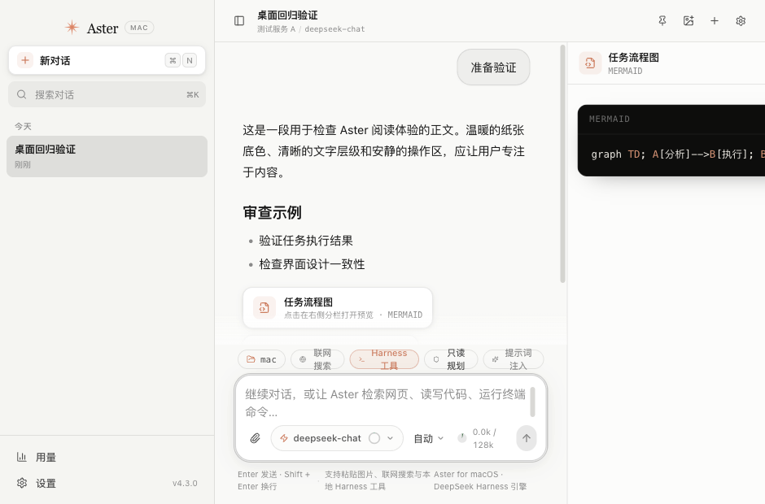
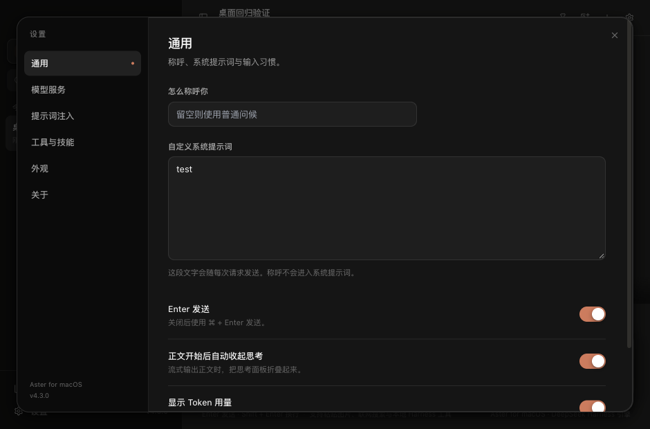

# Aster Mac：任务执行能力与设计一致性审查

审查日期：2026-11-06。审查对象为上轮 14 类缺陷整改后的工作区及其打包产物。本轮没有修改产品实现或提示词注入模块。

## 结论

当前 Aster 具备流式聊天和基础工具循环，能够承担短程的读取、修改、命令执行和检索任务。尚不能认定它具备与 dsh 相当的复杂任务完成能力。主要差距在任务生命周期、完整工具历史、长任务进程管理、上下文压缩、子智能体和能力扩展；同名工具不是完整运行时的替代。

上轮 24 项回归测试验证的是已定位缺陷的修复，没有覆盖本报告的长任务能力验收。不能用“全部通过”推导出“已经与 dsh 对齐”。本轮的模拟模型响应能确定性暴露调度和状态问题，不构成真实模型任务成功率测评。

前端具备陶土强调色、轻量侧栏和聊天输入框的基本方向，但同时混用了第三方 CDS 变量、硬编码样式和手机端 Aster 语义，尚未形成一致的桌面设计系统。窄窗口工作台还存在明确的功能性布局缺陷。

## 审查依据

- 官方 dsh 仓库：`deepseek-ai/deepseek-harness`，读取时版本 `0.2.2-rc.1`，固定提交 `fcc0ad462172522aaf5c93a7b2e01f6b9f0b0159`。
- [dsh 架构](https://github.com/deepseek-ai/deepseek-harness/blob/fcc0ad462172522aaf5c93a7b2e01f6b9f0b0159/docs/architecture.md)、[SDK 客户端](https://github.com/deepseek-ai/deepseek-harness/blob/fcc0ad462172522aaf5c93a7b2e01f6b9f0b0159/packages/sdk/client/README.md)、[SDK 运行配置](https://github.com/deepseek-ai/deepseek-harness/blob/fcc0ad462172522aaf5c93a7b2e01f6b9f0b0159/packages/bundle/sdk-app/README.md)。功能对照以各模块的源码和 README 为依据。
- 手机端：相邻 `aster` 项目中的 `ui/theme/Theme.kt`、`ui/components/AsterDesign.kt`、聊天与产物组件。项目 README 引用的 `Caho1/open-claude-ui` 作为桌面布局参考，不把第三方还原说明当作 Claude 官方设计规范。
- 打包产物实际检查：1280×840 与 940×620，浅色、深色、聊天、工作台和设置；使用独立用户数据目录。
- 隔离行为复现：[后端记录](capability-results.json)、[桌面测量](observations.json)。未使用真实用户数据或 API 密钥。

## 后端：阻碍复杂任务完成的问题

| 编号 | 优先级 | 问题与证据 | 代码位置 | 对任务的影响 |
| --- | --- | --- | --- | --- |
| F01 | P1 | 工具循环固定 12 轮；达到上限后仍无条件发出 `done`。模拟需要 14 步的任务只请求 12 次，最终正文为空，最后一个 todo 仍为 `in_progress`。 | `electron/api.ts:30`、`:1416`、`:2085` | 未完成任务被显示为成功，缺少“达到预算／待继续”的状态。 |
| F02 | P1 | 下一次用户输入的历史只保留正文与图片，不保留工具调用和完整结果。已复现：工具活动内存着 `FILE_EVIDENCE_839174`，下一次模型请求没有这个内容。 | `src/state/store.ts:159`，`shared/types.ts` 的 `ChatTurn` | 模型无法可靠接续前一轮取得的证据；重启后也不能从已保存记录重建精确执行上下文。 |
| F03 | P1 | 上下文裁剪只在请求开始时执行，工具续轮持续追加结果。4096-token 配置下，连续读取一个 36000 字符文件，后续消息长度增至 36738、73072、109406 字符。 | `electron/api.ts:592`、`:1252`、`:2027` | 长任务很快超过模型上下文窗口；没有逐步测量、输出回收、摘要压缩与溢出恢复。 |
| F04 | P1 | Bash 命令固定 30 秒后被终止，输出只保留末尾 8000 字符；没有任务句柄、输出落盘或后台作业管理工具。 | `electron/tools.ts:1037`、`:1066`、`:1069` | 编译、依赖安装、下载和测试常会超时；模型只能自行拼装后台与轮询脚本，缺少运行时保证。 |
| F05 | P1 | 子智能体固定 `harnessToolsEnabled: false`，只有任务提示词，没有父级证据或本地读取工具。关闭联网时已确认子请求工具列表为空；父级也按顺序等待每个调用。 | `electron/api.ts:1387`、`:1402`、`:2017` | 委派“审查本地仓库”无法实际读取仓库；缺少可持续的子会话、并发、消息、等待与中断接口。 |
| F06 | P2 | 搜索遍历最多 6 层，跳过隐藏文件，grep 只取前 300 个候选文件，文件超过 512 KB 也跳过，而且不报告这些遗漏。305 个文件的目录中，仅最后一个文件含目标，结果仍为 `No matches found.`。 | `electron/tools.ts:975`、`:984`、`:1013`、`:1020` | 代码检索把“没有完整搜索”报告成“没有匹配”，可能漏掉 `.github`、`.env`、深层代码及大文件。 |
| F07 | P2 | Skill 安装只下载一份 Markdown 并截取 32000 字符，没有资源目录、脚本或依赖生命周期。GitHub `/tree/main/skills/example` 被错误转换为尾部多出 `/main/SKILL.md` 的地址。 | `electron/tools.ts:1094`、`:1105`、`:1126` | 与 dsh 的技能目录、资源和依赖提供者不同；复杂技能不能仅靠一份说明文字运行。 |
| F08 | P2 | 模型请求失败直接抛错，无暂时性网络故障、429、服务端错误的退避恢复及步骤级重试记录。 | `electron/api.ts:1549`、`:1556` | 长任务容易因一次暂时故障结束；手动重新生成也缺少完整工具历史支持。 |
| F09 | P2 | 子智能体回调只收集 `delta`，忽略 usage 和其他状态。本轮复现父级记录 13 tokens，子级另报的 1001 tokens 未计入。 | `electron/api.ts:1405` | 任务成本、子级执行记录和可观测性不完整。 |

dsh 对应模块包括：`core/agent-loop`、`core/session`、`compaction/compaction-basic`、`compaction/compaction-tool-result-pruner`、`llm/llm-retry`、`shell/tool-bash`、`jobs`、`subagent`、`fs/tool-fs-search`、`spill` 和 `skill`。持久终端属于需按目标配置组合的能力；dsh 自身的终端进程也不会在运行时重启后自动复活。

此外，Aster 目前没有接入 dsh 的插件系统、MCP、浏览器/桌面操作和 Office 资源运行环境。通用 Bash 可能在环境具备依赖时实现其中一些工作，但这不能视为已集成对应能力。具体需要哪些组件，应由任务范围决定，而非盲目启用全部插件。

## dsh 代码复用建议

官方核心代码采用 [MIT 许可](https://github.com/deepseek-ai/deepseek-harness/blob/fcc0ad462172522aaf5c93a7b2e01f6b9f0b0159/LICENSE)，可以复用和修改，分发时保留相应版权与许可。复用权限来自上游许可，不取决于 Aster 自己是否开源；引入的第三方组件保留各自许可，参见上游 `THIRD_PARTY_NOTICES.md`。

建议使用 `@deepseek-ai/dsh-sdk-client`，由 Electron 主进程启动受 Aster 管理的 dsh 子进程，通过 `sdk` profile 与 JSON-RPC 驱动实际运行时。该接口已经提供事件订阅、会话恢复、取消、用户问题和授权衔接。`sdk-minimal` 是精简配置，不能假定包含完整桌面能力。

建议的职责分配：

1. Aster 保有 React 界面、原生窗口、现有服务商配置、密钥存储和图片入口。
2. 新增主进程运行时桥接层，将会话、模型、工作区、权限和交互答复映射到 dsh；模型适配器需要验证现有 OpenAI Chat、Responses、Anthropic 及自定义网关的兼容性。
3. dsh 承担任务循环、工具执行、上下文压缩、后台作业、子智能体与可恢复的执行日志。界面从运行时事件投影状态，避免 UI 自行推断完成。
4. 给 Aster 使用独立的运行时数据目录和固定版本，核对 Node、原生依赖、打包、升级与退出清理。当前 dsh 源码要求 Node >=24.9.0，现有项目文档仍声明 Node >=20，集成时需更新运行环境约定。
5. 现有提示词注入模块及其执行路径保持原样；迁移任务引擎时单独验证两条路径的兼容性。

直接抽取少量 helper 比较适合补丁；若目标是“像 dsh 一样完成任务”，完整运行时复用更能保留相互依赖的生命周期行为。SDK 接入后仍需在相同模型、权限和环境下完成任务验收，不能仅靠接入成功推断能力等同。

## 前端：设计一致性和交互问题

以下将功能缺陷与设计判断分开。设计判断依据用户指定的 Claude 桌面布局与 Aster 手机端语言；不要求跨设备机械使用相同尺寸。

| 编号 | 类型/优先级 | 审查结果 | 证据/位置 | 建议 |
| --- | --- | --- | --- | --- |
| U01 | 功能 P1 | 工作台在窄窗口被裁切，关闭按钮不可见。940×620 下按钮右边界约 1122px，超出视口约 182px；`overflow-hidden` 掩盖了溢出。工具栏文字也被挤成多行。 | `src/components/ArtifactPane.tsx:75`，截图与测量 | 按可用内容宽度响应：自动折叠侧栏、使用覆盖式工作台或可调分栏，始终保证关闭按钮可达。 |
| U02 | 功能 P2 | `create_artifact` 声明支持 Mermaid、Markdown，工作台实际仅预览 HTML/SVG，其他类型落到 CodeBlock。 | `ArtifactPane.tsx:194`；实测 Mermaid 无 iframe，显示 `graph TD` | 补全对应渲染、预览/源码切换和适合产物的导出入口。 |
| U03 | 功能 P2 | Diff 逐行按相同下标比较，不计算行插入/删除的对齐；插入一行会把后续未修改内容大面积标成删除/新增。 | `ArtifactPane.tsx:25` | 使用真实的行差分算法，让代码整改结果可正确审阅。 |
| U04 | 交互 P2 | 模态层没有 `role=dialog`、`aria-modal`、焦点圈定和打开/关闭焦点恢复。实测打开设置后焦点仍在底层 textarea。 | `src/components/ui/Modal.tsx:33`；`modal-accessibility` 测量 | 让键盘与辅助功能的行为匹配视觉上的模态状态，阻止焦点和快捷键落到底层。 |
| U05 | 设计偏差 | 阅读正文与紧凑控件没有字体分工。实际正文为 14.5px 系统无衬线；手机端明确将长文正文设为 Serif、控件设为 Sans。只有欢迎标题、品牌字使用衬线，设置标题仍是普通粗体。 | `globals.css:40`、`:214`，手机 `Theme.kt:249` | 统一 editorial 排版语义，桌面正文建议从 15–16px 校准；代码、模型名与工具元信息继续使用适合的 Sans/Mono。 |
| U06 | 设计偏差 | 手机端暖纸张与深色语义未统一到 Mac。手机浅色 canvas/surface 为 `#F4F3EE/#FAF9F5`，Mac 用偏中性的 `#F9F9F7` 与纯白；手机深色 accent 为 `#E28769`，Mac 仍为 `#D97757`。Mac muted 为 `#666666`，在 `#151515` 上对比约 3.18:1，手机对应组合约 6.38:1。 | `cds-theme.css:87`、`:292`、`:350`，`globals.css:10`，手机 `Theme.kt:56` | 以统一的 Canvas/Surface/Ink/Muted/Accent/Sage 语义控制两种主题，提升细小辅助文字的可读性。 |
| U07 | 设计偏差与事实不符 | 输入区常驻工作区、联网、Harness、权限、注入入口、模型、推理、两套上下文指示与两行说明，信息层级拥挤。欢迎页和页脚还声称“DeepSeek Harness 原生工具集／引擎”，但实际没有接入该运行时。 | `Composer.tsx:302`、`:683`，`ModelPicker.tsx`，`Welcome.tsx:32` | 把主操作留给输入、模型、推理、发送；其余操作集中到工具菜单或按状态出现。文案准确表达实际能力，具体引擎信息放到关于页。注入模块的逻辑不在此项修改范围内。 |
| U08 | 设计偏差 | 已定义的圆角、强调色与动效令牌并未稳定成为组件单一来源。用户气泡写死 18px、设置 18px、popover/模型入口混用 pill/8px；Tailwind 又固定强调色。`motion.ts` 的弹簧预设未被主要交互使用，多数组件各自指定时间和 easing。 | `MessageItem.tsx:57`、`SettingsDialog.tsx:95`、`tailwind.config.js`、`src/lib/motion.ts` | 建立组件级规范：消息、输入框、面板、弹窗和按钮各有一套语义圆角；动效通过公共过渡或弹簧预设调用，保留 reduced-motion 行为。 |

### 窄窗口工作台

右侧标题栏操作被裁出屏幕，工具栏与页脚文字因挤压换行；这会直接妨碍工作台使用。

### 深色设置

可见辅助文字偏暗、标题和正文仍主要使用系统无衬线。布局检查同时发现键盘焦点没有进入模态层。

## 推荐整改顺序与验收

1. 先决定并接入真正的任务运行时，优先处理 F01–F05；以运行时事件统一驱动完成状态与执行记录。
2. 优先修复 U01–U04，使工作台与键盘交互可用，再统一字体、色彩、圆角和输入区信息层级。
3. 用可重复任务验收，而不仅验证接口是否调用成功：超过 20 步的代码整改、90 秒命令及取消、上千文件的深层/隐藏文件搜索、小上下文下持续工具输出、重启后接续证据、三个子智能体协作、429 恢复及子级用量统计。
4. 产物验收包含真实 Mermaid/Markdown 展示、正确行差分和可取得的交付文件；按目标配置加入浏览器、MCP 或 Office 后，再分别验收对应流程。
5. UI 验收覆盖 940×620、1280×840、更大窗口，浅/深主题、侧栏开关、工作台开关、长文、代码块、多问题和纯键盘操作。

本轮审查没有运行真实模型基准，也没有把 dsh 集成到 Aster。产品源文件和提示词注入模块未在本轮修改；本目录仅保存审查报告、测量记录和截图。
